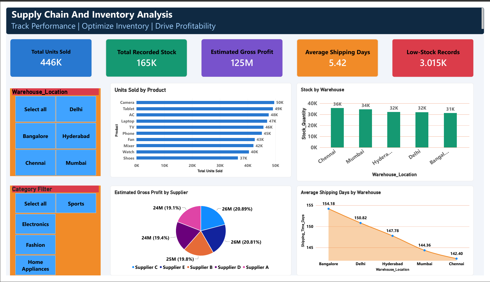

# Supply Chain & Inventory Analysis Dashboard

An end-to-end data analytics project focused on analyzing product sales, inventory levels, supplier profitability, warehouse stock distribution, and shipping performance using Python and Microsoft Power BI.

## Dashboard Preview

The Power BI dashboard provides an interactive overview of supply chain and inventory performance, including sales volume, recorded stock, estimated gross profit, shipping duration, and low-stock records.


## Project Overview

Effective supply chain management requires businesses to maintain appropriate inventory levels, monitor supplier performance, understand product demand, and evaluate shipping efficiency.

This project analyzes supply chain and inventory data to identify sales patterns, monitor stock availability, compare supplier contributions to estimated gross profit, and evaluate shipping performance across warehouses.

The project combines Python-based data cleaning and exploratory data analysis with an interactive Power BI dashboard to transform raw data into actionable business insights.

## Business Problem

Businesses may experience inventory shortages, excess stock, inconsistent supplier performance, and delays in product delivery when supply chain data is not analyzed effectively.

The objective of this project is to use data analytics to answer key business questions:

- Which products generate the highest sales volume?
- Which products contribute the most to estimated gross profit?
- Which warehouses hold the highest recorded stock?
- Which warehouses have the most records at or below reorder level?
- Which suppliers contribute the most to estimated gross profit?
- What is the average shipping duration?
- How can inventory and supply chain performance be monitored through an interactive dashboard?

## Project Objectives

- Inspect and clean the raw dataset.
- Validate data quality and consistency.
- Perform exploratory data analysis (EDA) using Python.
- Calculate product-level estimated gross profit.
- Analyze inventory levels against reorder thresholds.
- Compare product, supplier, and warehouse performance.
- Prepare an analysis-ready dataset for Power BI.
- Develop an interactive dashboard with KPI cards, charts, and slicers.
- Communicate findings that can support operational decision-making.

## Tools and Technologies

| Tool               | Purpose                                   |
| ------------------ | ----------------------------------------- |
| Python             | Data inspection, cleaning, and analysis   |
| Pandas             | Data manipulation and validation          |
| NumPy              | Numerical operations                      |
| Matplotlib         | Data visualization                        |
| Jupyter Notebook   | Interactive analysis and documentation    |
| Microsoft Power BI | Interactive dashboard development         |
| CSV                | Data exchange between Python and Power BI |
| Git and GitHub     | Version control and project portfolio     |

## Dataset Description

The project uses a supply chain dataset containing **15,000 records**.

The original dataset includes 13 columns covering products, suppliers, warehouses, inventory, costs, sales, and delivery dates.

### Key columns

| Column               | Description                          |
| -------------------- | ------------------------------------ |
| `Product_ID`         | Unique product identifier            |
| `Product_Name`       | Product name                         |
| `Category`           | Product category                     |
| `Supplier_Name`      | Supplier associated with the product |
| `Order_Date`         | Order date                           |
| `Delivery_Date`      | Delivery date                        |
| `Stock_Quantity`     | Recorded stock quantity              |
| `Reorder_Level`      | Inventory reorder threshold          |
| `Units_Sold`         | Units sold                           |
| `Purchase_Cost`      | Purchase cost per unit               |
| `Selling_Price`      | Selling price per unit               |
| `Warehouse_Location` | Warehouse location                   |
| `Shipping_Time_Days` | Shipping duration in days            |

Additional derived columns were created during data preparation and Power BI analysis.

- `Profit_Per_Unit`: Selling price minus purchase cost.
- `Total_Gross_Profit`: Profit per unit multiplied by units sold.
- `Inventory_Status`: Classification of inventory records based on reorder thresholds.

## Project Workflow

### 1. Data Inspection and Cleaning

The raw dataset was inspected using Python and Pandas.

Key validation checks included:

- Missing and null values.
- Duplicate records.
- Unique product identifiers.
- Negative numeric values.
- Date consistency.
- Delivery dates occurring before order dates.
- Consistency between shipping duration and order/delivery dates.
- Selling prices compared with purchase costs.

**Data quality findings:**

- Total records inspected: 15,000.
- Missing values: None identified in the validated dataset.
- Duplicate rows: None identified.
- Unique product IDs: 15,000.
- Negative numeric values: None identified in the validated dataset.
- Invalid delivery date sequences: None identified.
- Shipping duration inconsistencies: None identified.
- Records where selling price was greater than purchase cost: All records.

These checks helped establish a consistent dataset for further analysis.

### 2. Exploratory Data Analysis

Exploratory data analysis was performed to understand product sales, estimated gross profit, inventory distribution, supplier performance, and shipping duration.

The analysis included:

- Product-wise sales analysis.
- Product-wise estimated gross profit analysis.
- Warehouse stock analysis.
- Low-stock record analysis.
- Supplier-wise estimated gross profit analysis.
- Shipping duration analysis.

Visualizations were used to identify patterns and compare performance across business dimensions.

### 3. Feature Engineering

Additional fields were created to support profitability and inventory analysis.

**Profit per unit**

`Profit_Per_Unit = Selling_Price - Purchase_Cost`

**Estimated gross profit**

`Total_Gross_Profit = Profit_Per_Unit × Units_Sold`

**Inventory status**

Inventory records were classified according to whether stock was at or below the reorder level.

These derived fields enabled more meaningful analysis in Power BI.

**Metric limitation:** Estimated gross profit is calculated from the available purchase cost and selling price fields. It does not deduct shipping, warehousing, administrative, or other operating expenses and should not be interpreted as net profit.

### 4. Power BI Dashboard Development

An interactive dashboard was developed in Microsoft Power BI to present the main performance indicators and business findings.

#### KPI Cards

The dashboard includes five key performance indicators:

1. **Total Units Sold** — Sum of units sold.
2. **Total Recorded Stock** — Sum of recorded stock quantities.
3. **Estimated Gross Profit** — Sum of estimated gross profit.
4. **Average Shipping Days** — Average shipping duration.
5. **Low-Stock Records** — Number of records at or below the reorder level.

#### Visualizations

The dashboard uses multiple visual types to explore different aspects of supply chain performance, including product sales, warehouse stock distribution, supplier profitability, and shipping duration.

#### Interactive Filters

The dashboard includes:

- Warehouse filter.
- Category filter.

These slicers allow users to investigate performance for selected warehouses and product categories.

## Key Business Findings

The analysis produced the following findings:

| Business Metric                              | Finding        |
| -------------------------------------------- | -------------- |
| Top-selling product                          | Camera         |
| Camera units sold                            | 240,401        |
| Product with highest estimated gross profit  | Camera         |
| Camera estimated gross profit                | 67,289,924.00  |
| Warehouse with highest recorded stock        | Bangalore      |
| Bangalore recorded stock                     | 761,135 units  |
| Warehouse with most low-stock records        | Chennai        |
| Chennai low-stock records                    | 629            |
| Supplier with highest estimated gross profit | Supplier E     |
| Supplier E estimated gross profit            | 125,550,272.00 |
| Average shipping duration                    | 5.50 days      |
| Records at or below reorder level            | 3,015          |

### Business Interpretation

**1. Product performance**

Camera was the leading product in both units sold and estimated gross profit. This finding highlights the importance of monitoring demand and profitability at the product level.

**2. Warehouse inventory**

Bangalore had the highest recorded stock, while Chennai had the largest number of low-stock records. These findings support further investigation of warehouse-level inventory allocation and replenishment needs.

**3. Supplier performance**

Supplier E had the highest estimated gross profit contribution in the analysis. Supplier performance can be investigated further alongside purchasing costs, delivery reliability, and supplier-specific product mix.

**4. Shipping performance**

The average shipping duration was 5.50 days. This metric provides a baseline for monitoring shipping performance and identifying opportunities to improve delivery efficiency.

**5. Replenishment monitoring**

A total of 3,015 records were at or below their reorder level. These records can be prioritized for inventory review, subject to actual demand, lead times, and replenishment policies.

## Business Recommendations

Based on the findings, the following actions could be considered:

- Monitor high-demand products such as Camera to ensure inventory availability.
- Review stock distribution across warehouses, especially where inventory is low relative to reorder thresholds.
- Investigate Chennai's low-stock records to identify possible replenishment requirements.
- Evaluate Supplier E's performance using additional measures such as delivery reliability, purchasing terms, and product mix.
- Track shipping duration regularly and investigate warehouses or orders with unusually long delivery times.
- Use reorder levels alongside demand forecasts and supplier lead times to improve replenishment decisions.
- Review profitability using complete operating-cost data before making decisions based on net profitability.

These are recommendations for further investigation, not proof that a particular operational issue or cause exists.

## Repository Structure

The project was organized into separate folders for data, notebooks, outputs, and reports.

```text
Supply-Chain-Inventory-Analysis/
│
├── data/
│   ├── Supply_Chain_Cleaned.csv
│   └── Supply_Chain_PowerBI.csv
│
├── notebooks/
│   ├── 01_Data_Inspection.ipynb
│   ├── 02_Exploratory_Data_Analysis.ipynb
│   └── 03_PowerBI_Data_Preparation.ipynb
│
├── outputs/
│   └── Analysis charts and generated outputs
│
├── reports/
│   └── Dashboard screenshots and project reports
│
└── README.md
```

_Note: The structure above describes the intended organization. Include only files and folders that are present in your actual GitHub repository._

## How to Explore the Project

1. Clone or download the repository.
2. Open the Jupyter notebooks in order.
3. Review the data inspection and cleaning process.
4. Explore the exploratory data analysis and visualizations.
5. Review the Power BI preparation notebook.
6. Open the Power BI report file, if included in the repository.
7. Use the dashboard slicers to explore warehouse and category performance.

### Python Environment

The analysis uses common Python data analytics libraries.

Install the core dependencies with:

```bash
pip install pandas numpy matplotlib jupyter
```

Launch Jupyter Notebook with:

```bash
jupyter notebook
```

The Power BI dashboard requires Microsoft Power BI Desktop to open a `.pbix` report file.

## Skills Demonstrated

- Data cleaning and validation.
- Exploratory data analysis.
- Data manipulation using Pandas and NumPy.
- Data visualization using Matplotlib.
- Feature engineering and calculated metrics.
- Inventory and reorder-level analysis.
- Product and supplier performance analysis.
- Power BI dashboard development.
- KPI design and interactive filtering.
- Business insight generation.
- Analytical communication and documentation.

## Project Limitations

- The dataset may not represent a real company's operational records.
- Estimated gross profit excludes operating and logistics expenses.
- High stock quantity alone does not establish overstocking; demand and lead-time information must also be considered.
- Low-stock records identify potential replenishment priorities but do not automatically mean that every record requires an immediate purchase.
- Observed relationships should not be interpreted as causal without additional analysis.
- Findings are limited to the fields and records available in the dataset.

## Future Improvements

Potential extensions include:

- Demand forecasting for inventory planning.
- Supplier delivery reliability analysis.
- Warehouse replenishment prioritization.
- Inventory turnover and days-of-inventory calculations.
- More detailed shipping delay analysis.
- Profitability analysis including operating expenses.
- Automated data refresh and reporting.
- Additional drill-through pages for product and warehouse details.

## Conclusion

This project demonstrates an end-to-end data analytics workflow, from data inspection and cleaning to exploratory analysis, feature engineering, and interactive Power BI reporting.

The resulting dashboard provides visibility into product sales, recorded inventory, estimated gross profit, supplier contributions, and shipping duration. The findings can help guide further investigation into inventory planning, supplier evaluation, and supply chain performance.

---

**Author:** Ankit Kumar Tripathi

**Project:** Supply Chain & Inventory Analysis

**Tools:** Python, Pandas, NumPy, Matplotlib, Jupyter Notebook, Microsoft Power BI

**Portfolio:** Add your GitHub repository and LinkedIn profile links here.


